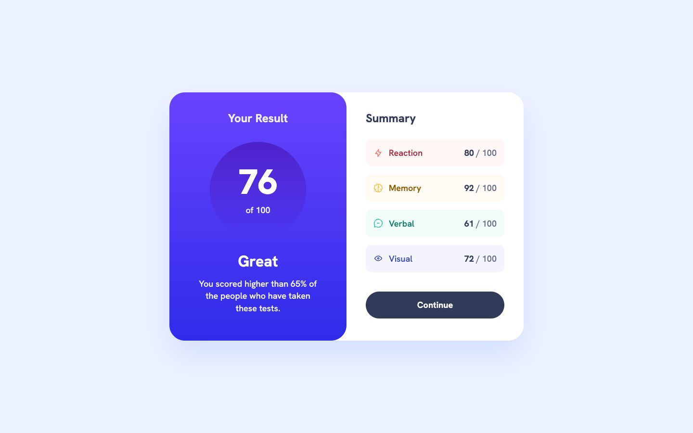

# Frontend Mentor - Results summary component solution

This is a solution to the [Results summary component challenge on Frontend Mentor](https://www.frontendmentor.io/challenges/results-summary-component-CE_K6s0maV). The app shows the supplied sample scores in a responsive results card.

## Table of contents

- [Overview](#overview)
  - [The challenge](#the-challenge)
  - [Screenshot](#screenshot)
  - [Links](#links)
- [My process](#my-process)
  - [Built with](#built-with)
  - [What I learned](#what-i-learned)
  - [Continued development](#continued-development)
- [Run it locally](#run-it-locally)
- [Author](#author)

## Overview

### The challenge

Users should be able to:

- View the results card in a layout that fits their screen size.
- Read the overall result and the Reaction, Memory, Verbal, and Visual scores.
- See hover and focus states for interactive elements.

### Screenshot



### Links

- Solution URL: [My Frontend Mentor solution](https://www.frontendmentor.io/solutions/results-summary-with-nextjs-typescript-and-tailwind-iIKhiIAvTw)
- Live Site URL: [Results Summary](https://results-summary.royeradames.com)

## My process

### Built with

- Next.js and React
- TypeScript
- Tailwind CSS and custom CSS
- Semantic HTML, including a definition list and native disclosure
- CSS Grid and Flexbox
- Locally hosted Hanken Grotesk font
- Playwright for browser checks
- ESLint for linting

### What I learned

Restoring my old Angular repo showed that the last deployed version carried the wrong branding ("WeatherBound") and a mock login. I learned to check what a hostname actually serves before trusting a recorded alias. The current page uses the Results Summary title and removes that unrelated login toggle.

I kept the repo and its `master` branch while moving the implementation to Next.js and Tailwind CSS. The original Angular version remains in Git history at `0b15e36`. Changing the stack did not mean losing the earlier work.

I kept the scores in the supplied JSON and calculated the overall result from them. I used native `<details>` and `<summary>` for Continue so it can explain the end of the sample with keyboard controls and no custom click handler. There is no connected assessment or stored result.

### Continued development

- My automated width sweep stops at 1600 px. Larger screen widths are the next gap to check.

## Run it locally

Use Node.js 24. Install dependencies and start development:

```sh
npm ci
npm run dev
```

Run the existing checks in this order. Playwright starts a server against the production build:

```sh
npm run lint
npm run typecheck
npm run build
npm test
```

The Playwright server uses port `4388`; `PORT` overrides it. The tests use Chrome. `tests/design.spec.ts` checks the design frames, site identity, and widths from 320 to 1600 px in 10 px steps.

These are Frontend Mentor sample results. I use local JSON data, with no accounts, tracking, stored results, or connected assessment. Continue opens a native disclosure explaining the end of the sample. Visual is **72** in the supplied JSON and earlier implementation, though the reference image shows 73. The overall score, 76, is the rounded mean of the four scores. The 65% comparison is supplied sample copy, not a calculated ranking or a real user result.

I followed the Figma desktop at 1440 px, tablet at 768 px with side-by-side panels and 41 px gutters, and mobile at 375 px. The card is centred on tablet and desktop; on mobile it starts at the top, as in the design. My adaptations include a 16 px text floor, stronger contrast, visible keyboard focus, and an explicit sample label. I darkened the category and lavender text colours and changed the result gradient's starting colour from `#7755ff` to `#6943ff` to meet the 4.5:1 text contrast target.

The older `angular-results-summary-component.royeradames.com` hostname redirects to the live site above. `og:site_name` and WebSite JSON-LD both use "Results Summary".

The supplied local data, category icons, Hanken Grotesk font, and design references remain credited in [the reference notes](./reference/README.md). The original assets are preserved under `public/assets`.

## Author

- Website - [Royer Adames](https://royeradames.com)
- Frontend Mentor - [@royeradames](https://www.frontendmentor.io/profile/royeradames)
